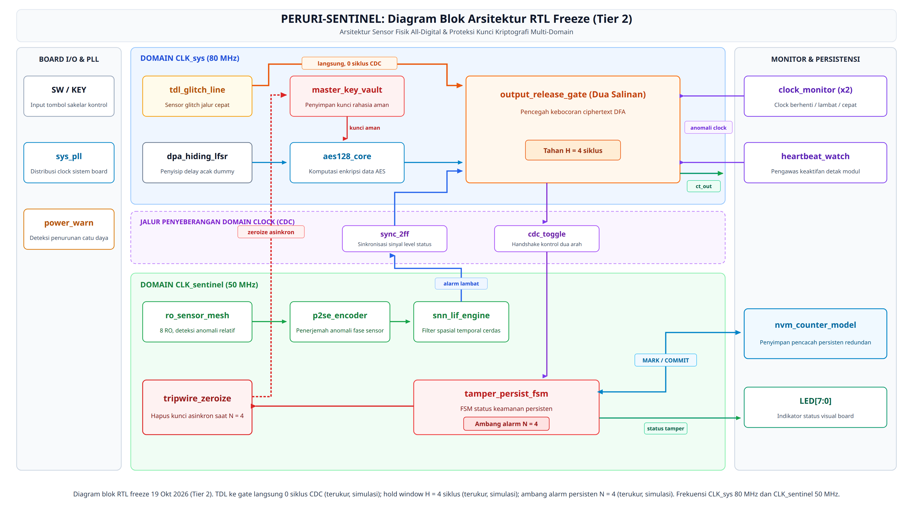
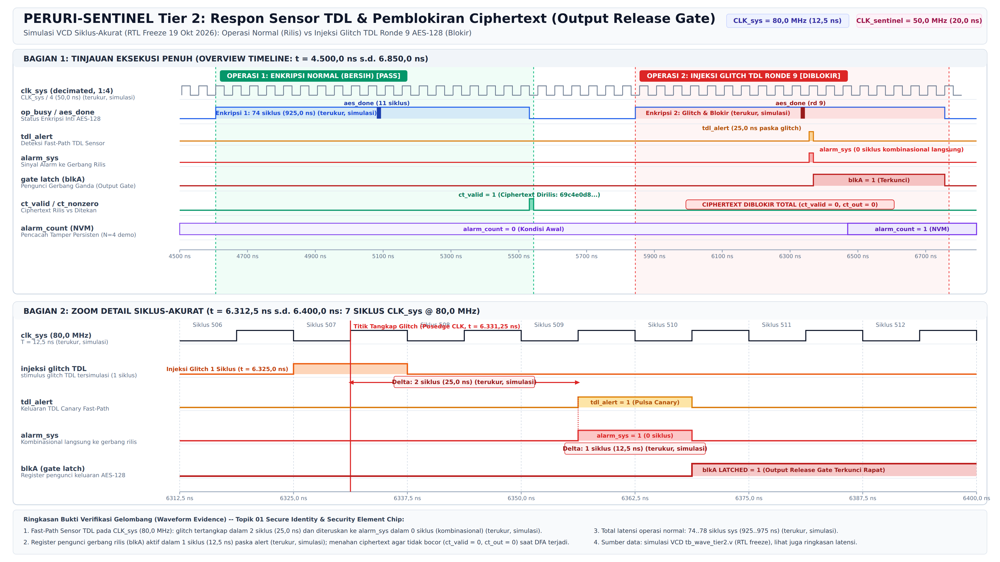
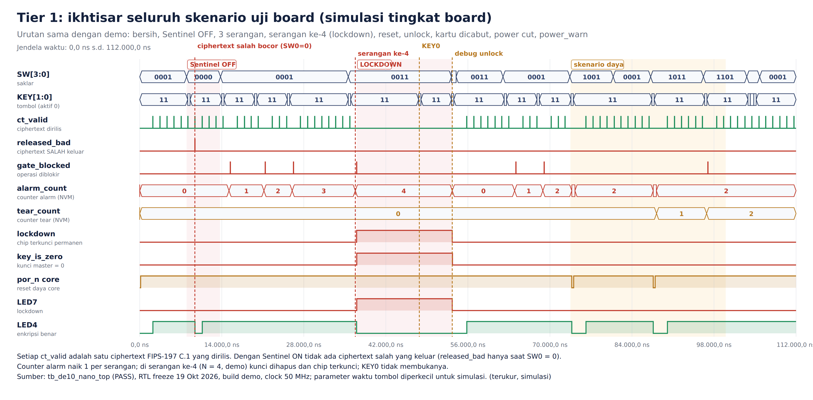
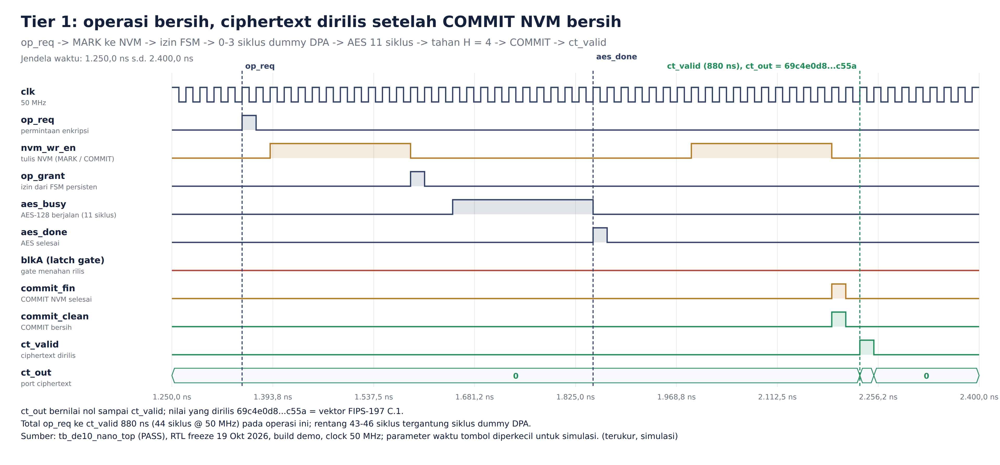

# PERURI-SENTINEL

All-digital fault-attack sensor and key-protection IP for sovereign secure elements (e-Paspor). Designed for the PERURI Chip Hackathon 2026, Topik 01 (Secure Identity & Security Element Chip).

The design layers three defences. A tapped delay line (TDL) glitch canary on the attacked clock reacts within 2 cycles, 25 ns at 80 MHz (measured, simulation), and an 8-node ring oscillator mesh tracks slower drift over about 2 to 4 µs (estimasi). A multiplier-free leaky integrate-and-fire (LIF) filter separates local anomalies from environmental drift. An output release gate (dual-copy single-fault tolerant) holds ciphertext until the sensors report clean and NVM state commits, and graduated tamper response with persistent NVM counters and asynchronous key zeroization limits denial of service. Always-on DPA hiding (0 to 3 random dummy cycles via a 16-bit Fibonacci LFSR) slightly increases the cost of DPA attacks (menaikkan biaya serangan DPA sedikit). Target platforms: Terasic DE10-Nano (Cyclone V SoC) for the demonstration and SkyWater sky130A through LibreLane for the ASIC flow.

## Gambar



*Gambar 1. Diagram blok RTL freeze 19 Okt 2026 (Tier 2): CLK_sys 80 MHz (domain diserang) dan CLK_sentinel 50 MHz (domain pengawas). Alert TDL menuju output release gate langsung tanpa CDC. `tamper_persist_fsm` memakai NVM dua salinan ber-CRC. `clock_monitor` dan `heartbeat_watch` mengawasi clock dan keaktifan domain. Zeroize asinkron ke key vault.*



*Gambar 2. Glitch clock pada CLK_sys 80 MHz ditangkap TDL dalam 2 siklus (25 ns), alert ke alarm gate 0 siklus, latch gate 1 siklus, ciphertext ditahan (ct_valid = 0, ct_out = 0) (terukur, simulasi).*



*Gambar 3. Seluruh skenario demo Tier 1 dari simulasi tingkat board: ciphertext salah hanya keluar saat Sentinel OFF; counter alarm naik per serangan; serangan ke-4 (N = 4, demo) menghapus kunci dan mengunci chip; reset pengguna tidak membuka lockdown; skenario cabut kartu, power cut, dan power_warn (terukur, simulasi).*

Keterangan gambar lain ada di [diagrams/README.md](diagrams/README.md).

---

## 1. Threat Model & Physics of Physical Attacks

When an adversary gains physical possession of a sovereign identity document (such as an Indonesian e-Passport or e-KTP), attacks shift from software vulnerabilities to physical penetration:

```
[ PHYSICAL ADVERSARY ]
         │
         ├──► 1. Clock Glitch / Voltage Droop ────► Setup/Hold Violation ──► Instruction Skip / DFA
         ├──► 2. Laser / Optical Injection ──────► Substrate Photo-Current ─► Single Event Upset (SEU)
         └──► 3. Differential Power Analysis ────► Passive Current Traces ──► Master Key Recovery
                                                              │
                                                    [ FATAL EXPLOITATION ]
```

### Fault Injection (FI) & DFA Mitigation
* **Clock Glitches & Voltage Droop (DFA):** An external attacker deliberately introduces a nanosecond-level pulse into the clock pin or drops the power supply voltage ($V_{dd}$) during a critical cryptographic round (e.g., Round 8 or Round 9 of an AES-128/256 operation). This induces setup-time violations ($t_{su}$), causing intermediate state registers to latch corrupted data. If the resulting faulty ciphertext is released, Differential Fault Analysis (DFA; Piret & Quisquater 2003, Biham & Shamir 1997) deduces the private key in minutes with minimal cipher calculations. **Key Architectural Defense:** DFA is defeated not by post-facto key clearing alone, but by an **Output Release Gate** that suppresses faulty ciphertexts from ever reaching the bus. In our hardened implementation, the gate employs a dual-copy complementary state machine with registered staging, dual-rail validity, and parity verification, ensuring single-fault tolerance.
* **Laser Fault Injection (LFI) & Optical Probing:** A focused infrared laser strike photo-generates electron-hole pairs in the silicon substrate, flipping target bits in registers (Single Event Upsets) to bypass authentication loops (`if (auth_ok == true)`).
  * *Limitation Note:* The 8-node Ring Oscillator mesh provides coarse floorplan monitoring and has limited spatial coverage against micron-scale localized laser spots. Denser substrate sensor grids are designated as future work.

### Side-Channel Analysis (SCA)
* **DPA / CPA:** By sampling instantaneous current draw over thousands of cryptographic rounds using an external oscilloscope on a shunt resistor, an attacker correlates power consumption with the Hamming weight of intermediate cipher states. Because external shunt measurements are completely passive and leave zero electrical footprint on-chip, **silicon hardware cannot detect ongoing DPA recording sessions**. Countermeasures must therefore be **ALWAYS-ON**, inserting a random start delay of 0 to 3 dummy cycles (via a 16-bit Fibonacci LFSR) to slightly increase the cost of DPA attacks (menaikkan biaya serangan DPA sedikit). No clock phase dithering, frequency modulation, or passive DPA detection is implemented.

### Why Conventional Countermeasures Fail
* **Static Analog Detectors:** Process, Voltage, and Temperature (PVT) variations across dies, combined with silicon aging, force wide safety margins on fixed comparators, creating blind spots for calibrated micro-glitches. Moreover, open-source PDKs (SkyWater 130nm / Chip Merah Putih) lack hardened analog sensor IP libraries. An adaptive digital baseline enables tighter thresholds with low false-alarm rates.
* **Dual-Rail Precharge Logic:** Substantially increases silicon area and dynamic power, which is prohibitive for low-cost smart card footprints.
* **Comparison with Temporal Redundancy:** Executing encryption twice and comparing results doubles latency (100% overhead), fails against identical persistent glitches hitting both cycles, and leaves non-cryptographic control flow (e.g., `auth_ok` branches) unprotected. On-chip digital sensors provide complementary defense-in-depth.

---

## 2. Physical Telemetry & On-Chip Sensor Network

Peruri-Sentinel integrates an all-digital, distributed sensor mesh across the silicon floorplan that monitors operational integrity:

```
       ┌────────────────────────────────────────────────────────┐
       │           ALL-DIGITAL ON-CHIP TELEMETRY FABRIC         │
       └───────────────────────────┬────────────────────────────┘
                                   │
         ┌─────────────────────────┴─────────────────────────┐
         ▼                                                   ▼
┌──────────────────┐                                ┌──────────────────┐
│ Fast Path: TDL   │                                │ Slow Path: RO    │
│ Canary Sensor    │                                │ Mesh (8 Nodes)   │
├──────────────────┤                                ├──────────────────┤
│ Samples CLK_sys  │                                │ Gate Window      │
│ 2 Cycles(terukur)│                                │ 2-4 µs (Estimasi)│
└────────┬─────────┘                                └────────┬─────────┘
         │                                                   │
         └─────────────────────────┬─────────────────────────┘
                                   ▼
                  [ 12-Channel Digitized Vector ]
```

### Tapped Delay Line (TDL) Canary Glitch Sensors (Fast Path)
* **Mechanism:** High-speed carry chains (implemented using Cyclone V ALM fast-carry structures or cascaded delay stages in Sky130).
* **Observation Target:** Samples the attacked system clock (`CLK_sys`) directly (Zick et al., FPGA 2013).
* **Function & Timing:** Any sub-nanosecond clock glitch or transient $V_{dd}$ droop prevents the test edge from traversing its nominal distance, causing an immediate deviation in the TDL register vector within **2 CLK_sys cycles, 25 ns at 80 MHz (measured, simulation)**.

### Distributed Ring Oscillator (RO) Mesh (Slow Path)
* **Mechanism:** Eight small Ring Oscillators (odd-numbered inverter loops) placed across the floorplan near key registers and cipher datapaths. Synthesized with `(* syn_keep = 1 *)` / `(* keep, dont_touch *)`.
* **Physics & Window Calculation:** An oscillator's frequency ($f_{RO} \approx \frac{1}{2 \cdot N \cdot t_{pd}(V_{dd}, T)}$) shifts with temperature and substrate voltage. Cycle counters evaluate frequencies over a parameterizable gate window (`RO_WINDOW` set to 256-512 cycles, estimasi 2,13 µs to 4,27 µs at the 120 MHz ASIC target). Relative frequency resolution is approximately $1/(f_{RO} \times T_{window})$: for $f_{RO} \approx 250$ MHz and $T_{window} \approx 2,13$ µs the counter accumulates about 533 counts, giving about 0,19% (estimasi). Latency is in microseconds (**estimasi 2 to 4 µs**), serving as a slow-drift thermal and supply monitor.

### Clock Tampering & Liveness Monitoring (Tier 2: Clock Monitor & Heartbeat Watchdog)
To guard against clock manipulation, clock freezing, and fail-silent attacks:
* **Clock Monitor (`clock_monitor`):** Operates using an independent, always-running ring oscillator (`ro_cell`) as a local reference time base. Dedicated monitor instances observe `CLK_sys` and `CLK_sentinel` over counting windows (`MON_WINDOW`). Detects stopped clocks, gross underclocking (< 1/4x), and overclocking (> 2x). In simulation (terukur, simulasi), a stopped `CLK_sys` is detected within 840 ns, gross underclocking (< 1/4x) within 1.740 ns, and gross overclocking (> 2x) within 1.730 ns; a stopped `CLK_sentinel` is detected within 1.740 ns. Detected anomalies immediately raise sticky alarm flags and block the release gate.
* **Heartbeat Watchdog (`heartbeat_watch`):** Provides a direct cross-domain liveness check between `CLK_sys` and `CLK_sentinel` independent of the oscillator time base. Each domain periodically toggles a heartbeat line; the companion domain synchronizes the edge and asserts a timeout fault if no transition occurs within the timeout window (`HB_TO`). In simulation (terukur, simulasi), a stopped `CLK_sentinel` is flagged by the heartbeat watchdog within 5.320 ns.

---

## 3. Neuromorphic Edge AI Core Microarchitecture

Daripada menerapkan arsitektur 2D CNN konvensional yang membutuhkan puluhan blok DSP multiplier dan latensi komputasi tinggi, Peruri-Sentinel mengimplementasikan filter spatio-temporal Spiking Neural Network (SNN) berbasis dinamika Leaky Integrate-and-Fire (LIF) neuron.

```
       [ 12-Channel Digitized In-Silicon Telemetry Vector ]
       (8-ch RO Delta Freq + 4-ch TDL Canary Fast Glitch)
                          │
                          ▼
┌────────────────────────────────────────────────────────┐
│      PHASE-TO-SPIKE DELTA ENCODER (P2SE)               │
│      Mengonversi rate-of-change (Δf/Δt) menjadi spike  │
└────────────────────────┬───────────────────────────────┘
                         │ 12 Jalur Spike Paralel
                         ▼
┌────────────────────────────────────────────────────────┐
│      12x8 LEAKY INTEGRATE-AND-FIRE (LIF) NEURONS       │
│                                                        │
│   V[t] = β · V[t-1] + Σ (W_ij · S_j[t])                │
│                                                        │
│   • Datapath Multiplier-Free (Shift-and-Add)           │
│   • Bobot offline terkonfigurasi pada M10K ROM         │
└────────────────────────┬───────────────────────────────┘
                         │ Layer 1 Anomaly Spikes
                         ▼
┌────────────────────────────────────────────────────────┐
│      TEMPORAL COINCIDENCE DETECTOR (OUTPUT LAYER)      │
│      Mengevaluasi korelasi anomali multi-node          │
└────────────────────────┬───────────────────────────────┘
                         │
        ┌────────────────┴────────────────┐
        ▼                                 ▼
[ Output Release Gate Abort ]     [ tamper_persist_fsm (NVM) ]
```

### Formulasi Matematis: LIF Leaky Integrator Tanpa Multiplier
Secara matematis, satu neuron LIF dengan input biner beroperasi sebagai leaky integrator (IIR filter orde-satu dengan ambang batas diskrit). Potensial membran setiap neuron $i$ dihitung pada setiap siklus clock:

```math
V_i[t] = \left(V_i[t-1] - (V_i[t-1] \gg \mathrm{LEAK\_SHIFT})\right) + \sum_{j=1}^{12} W_{ij} \cdot S_j[t]
```

Keterangan variabel:
* $S_j[t] \in \lbrace 0, 1 \rbrace$ merepresentasikan keberadaan spike anomali dari kanal telemetri $j$ (8 kanal RO rate-of-change + 4 kanal TDL glitch alert).
* $W_{ij}$ adalah bobot integer bertanda 8-bit.
* Perkalian disederhanakan sepenuhnya menjadi operasi bitwise shift-and-add (multiplier-free datapath), sehingga tidak memerlukan blok DSP hard multiplier (0 DSP).

### Ambang Batas dan Pelepasan Spike
Jika $V_i[t] \ge V_{threshold}$:
1. Neuron menghasilkan spike output: $S_{out, i}[t] = 1$.
2. Potensial membran di-reset secara diskrit: $V_i[t] \leftarrow 0$.

### Latensi Reaksi Sensor Berdasarkan Jalur
* **TDL Canary (Fast Path):** Latensi dari glitch ke `tdl_alert` 2 siklus `CLK_sys` = 25 ns pada 80 MHz (terukur, simulasi); dari alert ke alarm gate 0 siklus (tanpa CDC) dan latch gate 1 siklus (terukur, simulasi). Jalur ini mendeteksi glitch clock dan transient voltage droop seketika sebelum setup time register terlanggar.
* **RO Mesh Counters (Slow Path):** Frekuensi dievaluasi melalui jendela pencacah `RO_WINDOW` (256-512 siklus clock, estimasi 2,13 µs sampai 4,27 µs bila dihitung pada target 120 MHz ASIC). Latensi berada pada skala mikrodetik (estimasi 2 sampai 4 µs) untuk mendeteksi drift termal dan manipulasi substrat lokal. Pada integrasi Tier 2, propagasi anomali RO hingga menghasilkan `alarm_sys` membutuhkan sekitar 10,3 µs (terukur, simulasi).

### Kalibrasi Bobot Offline dan Rencana Uji Ablasi
* **Sumber Bobot:** Bobot $W_{ij}$ tidak dilatih secara online di dalam silikon, melainkan dituning secara offline menggunakan rekaman jejak telemetri sensor RO/TDL pada board DE10-Nano di bawah variasi thermal sweep (25 °C hingga 60 °C) dan transient voltage droop.
* **Rencana Uji Ablasi:** Evaluasi komparatif akan dijalankan pada dataset jejak fisik yang identik:
  1. *Fixed Threshold:* Batas ambang frekuensi statis.
  2. *EWMA Filter:* Exponentially Weighted Moving Average linier tanpa deteksi spasial.
  3. *SNN-LIF dengan Spatial Coincidence:* Arsitektur usulan Peruri-Sentinel.
  * *Metrik Uji:* Detection rate terhadap fault injeksi nyata vs false-trigger rate pada variasi lingkungan wajar.

---

## 4. Arsitektur Pertahanan Berlapis, Output Release Gate, dan Graduated Response

Peruri-Sentinel menerapkan prinsip defense-in-depth dengan tiga lapisan proteksi perangkat keras:

```
                                  [ EVALUASI SENSOR & SNN ]
                                              │
         ┌────────────────────────────────────┼────────────────────────────────────┐
         ▼                                    ▼                                    ▼
[ ALWAYS-ON DPA HIDING ]           [ DETEKSI TRANSIENT ANOMALI ]       [ SERANGAN PERSISTEN TERKONFIRMASI ]
├─ Penundaan awal operasi acak      ├─ TDL Glitch / RO Frequency Alert  ├─ Tamper Counter >= N (Ambang Bahaya)
├─ 0-3 siklus dummy (LFSR 16-bit)   ├─ Dual-Copy Output Release Gate    ├─ Async Key Zeroize (3,514 ns)
└─ Menaikkan biaya DPA sedikit      └─ Increment Tamper Counter (+1)    └─ Permanent Lockdown Mode
```

### Lapisan 1: Always-On DPA Hiding (Bukan Deteksi Pasif)
Pengukuran osiloskop eksternal pada resistor shunt bersifat pasif dan tidak meninggalkan jejak elektrik di dalam silikon. Oleh karena itu, Peruri-Sentinel tidak mengklaim deteksi sesi DPA, melainkan menerapkan mitigasi aktif terus-menerus (always-on DPA hiding):
* Modul LFSR membangkitkan 0 hingga 3 siklus dummy acak (LFSR Fibonacci 16-bit) untuk sedikit menaikkan biaya serangan DPA (menaikkan biaya serangan DPA sedikit).
* Tidak ada manipulasi clock phase dithering, modulasi clock/fasa, maupun klaim deteksi DPA pasif.
* Mereduksi korelasi statistik konsumsi daya terhadap data rahasia tanpa membebani logika klasifikasi anomali.

### Lapisan 2: Output Release Gate (`output_release_gate`)
Modul ini merupakan benteng utama pencegahan Differential Fault Analysis (DFA):
* Ciphertext hasil komputasi AES ditahan di dalam register output internal dan tidak langsung dirilis ke bus eksternal. Selama operasi, keluaran tertahan dengan `ct_out = 0` dan `ct_valid = 0`.
* **Arsitektur Dual-Copy Redundan (Single-Fault Tolerant):**
  - Menggunakan dua salinan status kontrol independen: Salinan A menggunakan encoding state renggang (jarak Hamming minimal 4 antarkode legal), sedangkan Salinan B diimplementasikan pada domain komplemen bitwise (setiap register B menyimpan inversi bit dari A) dengan penghitung HOLD mandiri.
  - Pelepasan hasil terdaftar dua tahap (*two-stage registered release*): `ct_hold` menuju `ct_stage` (disetujui Salinan A) lalu menuju register `ct_out` (dikonfirmasi Salinan B). Tidak ada jalur kombinasional langsung dari register penahan ke port keluaran; rilis memerlukan konfirmasi simultan kedua salinan (`a_go` dan `b_go`).
  - Sinyal validitas keluaran `ct_valid` dikodekan secara *dual-rail* (`vp` sejati dan `vn` terinversi, `ct_valid = vp & ~vn`), sehingga *single bit flip* pada salah satu rail hanya dapat menekan (*suppress*) keluaran dan tidak dapat memaksa validitas palsu.
  - Bit paritas ciphertext diambil dari `ct_raw` pada `aes_done` dan diverifikasi terhadap `ct_stage` saat konfirmasi. Setiap ketidaksesuaian antarsalinan atau kode state ilegal membangkitkan `gate_fault`, membatalkan operasi, mengosongkan register internal, dan menyalurkan alarm ke kontroler tamper.
* **Logika Pemblokiran & Sinyal Alarm:**
  - Sinyal pemblokir `gate_block` menggabungkan tiga sumber: `tdl_alert_any` (langsung dari TDL pada `CLK_sys`, tanpa CDC), `env_alarm_sync` (alarm lambat yang bersifat *sticky*, melalui synchronizer 2-FF), dan `harness_alarm` (hanya pada build demo, bernilai 0 pada produksi).
  - Setelah ronde AES terakhir selesai, gate menahan ciphertext selama H = 4 siklus clock (estimasi: 2 siklus latensi TDL ditambah 2 siklus margin). Ciphertext hanya dirilis jika `gate_block` bernilai 0 selama operasi dan selama jendela H, serta kontroler tamper telah menyelesaikan komitmen NVM yang bersih (`commit_fin` dan `commit_clean`).
  - Jalur lambat tidak memutuskan satu operasi AES sendiri. Satu jendela RO lebih panjang daripada satu operasi AES, sehingga jaminan per operasi berasal dari jalur TDL, sedangkan jalur lambat menahan rilis selama alarm aktif.
* **Metrik Latensi Operasi dan Respon Gate:**
  - Pada Tier 1 @50 MHz: operasi normal `op_req` hingga `ct_valid` membutuhkan 43 hingga 46 siklus clock (860 hingga 920 ns) (terukur, simulasi). Alarm transien mengunci latch internal gate dalam 1 siklus (20 ns) (terukur, simulasi); injeksi fault pada ronde 9 menghasilkan pulsa `gate_blocked` dalam 18 siklus (terukur, simulasi).
  - Pada Tier 2 (CLK_sys 80 MHz, CLK_sentinel 50 MHz): operasi normal total membutuhkan 74 hingga 78 siklus sys (925 hingga 975 ns) (terukur, simulasi). TDL glitch alert bereaksi dalam 2 siklus (25 ns) (terukur, simulasi); alert langsung memicu latch internal gate dalam 1 siklus sys (12,5 ns) (terukur, simulasi); propagasi anomali RO ke `alarm_sys` membutuhkan sekitar 10,3 µs (terukur, simulasi).

### Lapisan 3: Graduated Response (Respon Bertingkat)
Alih-alih langsung menghapus kunci pada alarm pertama (yang berisiko mematikan paspor warga negara di bandara akibat false positive, atau menjadi celah Denial-of-Service):
1. **Alarm Tunggal:** Operasi kriptografi yang sedang berjalan dibatalkan (abort), output ditahan oleh Output Release Gate, dan register `tamper_counter` bertambah 1 per tepi naik sinyal alarm. Satu kejadian dihitung sekali per burst/kejadian, bukan per siklus.
2. **Ambang Batas Serangan ($N$ Kejadian):** Jika `tamper_counter` mencapai nilai batas $N$ (parameter; demo menggunakan $N = 4$, nilai produksi ditetapkan oleh penerbit dokumen keamanan), sistem menyimpulkan adanya serangan injeksi terencana.
3. **Zeroization & Permanent Lockdown:** Jalur asynchronous clear terpicu, menghapus master key dan register status dengan jalur clear asinkron maksimum 3,514 ns pada corner terburuk (1,763-3,514 ns di 4 corner) (terukur, STA Quartus, build RTL freeze 19 Okt, Tier 1) setelah `zeroize_req` melewati 1 siklus register sinkron (20,0 ns pada 50 MHz). Pada Tier 1, alarm ke-4 memicu zeroize dalam 14 siklus (280 ns) (terukur, simulasi). Pada Tier 2, alarm ke-4 memicu zeroize dalam 318,8 ns (terukur, simulasi). Penyerang yang sengaja menginjeksi N kejadian tetap dapat mengunci kartu; trade-off ini dipilih karena kebocoran kunci lebih merusak daripada kartu yang terkunci.

**Persistensi Penghitung NVM (`tamper_persist_fsm` & `nvm_counter_model`).**
Baik Tier 1 maupun Tier 2 mengimplementasikan persistensi status tamper menggunakan modul FSM tamper persisten (`tamper_persist_fsm`) dengan pemodelan memori non-volatil (`nvm_counter_model`):
* Dua pencacah independen tersimpan di dalam rekaman NVM: `alarm_count` (ambang batas $N = 4$ untuk demo) dan `tear_count` (ambang batas $M = 8$ untuk demo, mencatat operasi yang terpotong atau kehilangan daya selama eksekusi). Jumlah total percobaan penyerang dibatasi maksimal $N + M$.
* Penyimpanan NVM mengimplementasikan struktur dua salinan bergantian (*two-copy ping-pong*) yang dilindungi CRC-8 dan nomor urut transaksi (*sequence counter*), menjamin ketahanan terhadap pemutusan daya tiba-tiba (*power-cut/tearing*). Status lockdown dan pencacah bertahan melintasi siklus daya dan reset pengguna (`rst_n`).
* Gerbang rilis hanya membuka keluaran setelah FSM menyelesaikan penulisan komitmen NVM secara bersih (`commit_fin` bernilai 1 dengan `commit_clean = 1`).

### Isolasi Domain Clock dan Clock Domain Crossing (CDC)
* **Pemisahan Domain (Tier 2):**
  - **Domain Sistem Diserang (`CLK_sys`, target 120 MHz pada ASIC, 80 MHz pada FPGA Tier 2):** Menjalankan datapath AES-128 (`aes128_core`), `master_key_vault`, modul `dpa_hiding_lfsr`, sensor TDL (`tdl_glitch_line`), dan dual-copy `output_release_gate`. Alert TDL terhubung langsung ke gate tanpa CDC (0 siklus crossing) guna menjamin tidak ada ciphertext salah yang lolos.
  - **Domain Pengawas Terisolasi (`CLK_sentinel`, target 50 MHz):** Menjalankan mesh sensor RO (`ro_sensor_mesh`), encoder delta (`p2se_encoder`), engine inferensi `snn_lif_engine`, kontroler tamper persisten (`tamper_persist_fsm`), dan `tripwire_zeroize`.
* **Protokol Lintas Domain (CDC Handshake):**
  - Sinyal cepat (TDL alert, harness alarm) diperpanjang (*stretched*) selama `FAST_HOLD` siklus `CLK_sys`, lalu disinkronkan ke domain `CLK_sentinel` melalui synchronizer 2-FF (dihitung 1 kali per kejadian).
  - Sinyal alarm lambat dari detektor diperpanjang selama `SLOW_HOLD` siklus sentinel, lalu disinkronkan ke domain `CLK_sys` via synchronizer 2-FF untuk memblokir gate secara sticky.
  - Jabat tangan operasi NVM (`start`, `grant`, `op_done`, `commit`) antara `CLK_sys` dan `CLK_sentinel` diimplementasikan menggunakan toggle handshake (`cdc_toggle_tx` dan `cdc_toggle_rx`) yang terbukti tahan race condition dan pemutusan daya.
* **Pengawas Clock dan Keandalan (Fail-Secure Clock & Liveness Guard):**
  - Mengintegrasikan modul `clock_monitor` berbasis osilator ring terdedikasi (`ro_cell`) dan pengawas detak jantung (`heartbeat_watch`) untuk mendeteksi manipulasi clock, pembekuan clock, atau desinkronisasi domain. Sinyal kesalahan clock bersifat sticky dan langsung memblokir gate rilis serta memicu pencatatan alarm di NVM.

### Verifikasi Waktu Zeroization
Waktu propagasi jalur clear asinkron diukur dan diverifikasi melalui timing report Quartus Prime TimeQuest Static Timing Analysis (STA), yang menghasilkan jalur clear asinkron maksimum 3,514 ns pada corner terburuk (1,763-3,514 ns di 4 corner) (terukur, STA Quartus, build RTL freeze 19 Okt, Tier 1) setelah 1 siklus register sinkron (20,0 ns pada 50 MHz) dari `zeroize_req`. SignalTap Logic Analyzer tidak dapat mengukur delay fisik sub-siklus karena resolusinya dibatasi oleh periode sample clock; SignalTap digunakan khusus untuk memverifikasi urutan kejadian level siklus.

### Perbandingan dengan Redundansi Temporal (Encrypt Twice and Compare)
Teknik konvensional enkripsi ganda memiliki kelemahan: menggandakan latensi eksekusi (overhead 100%), tidak mampu menangkap fault identik yang menyerang kedua eksekusi, serta tidak melindungi instruksi non-kriptografi (seperti percabangan verifikasi `auth_ok`). Sensor fisik Peruri-Sentinel bersama Output Release Gate memberikan proteksi independen dengan overhead waktu minimal, dan dapat diposisikan sebagai lapisan komplementer.

---

## 5. Estimasi Implementasi Hardware: DE10-Nano & Sky130 ASIC

Desain Peruri-Sentinel menyeimbangkan densitas logika pada FPGA Cyclone V dan kelayakan fabrikasi silikon pada PDK SkyWater 130nm.

```
+---------------------------------------------------------------------------------+
|                 DE10-Nano: implementasi di FPGA fabric Cyclone V                |
|                                                                                 |
|  Board I/O: SW[3:0], KEY[1:0], LED[7:0], FPGA_CLK1_50 (50 MHz)                  |
|        |                                                                        |
|        v                                                                        |
|  +---------------------------------------------------------------------------+  |
|  |  FPGA Fabric Cyclone V 5CSEBA6U23I7                                       |  |
|  |                                                                           |  |
|  |  Tier 1 (de10_nano_top): satu clock 50 MHz, alarm dari KEY1 (demo)        |  |
|  |  Tier 2 (de10_nano_top_t2): PLL -> CLK_sys 80 MHz + CLK_sentinel 50 MHz   |  |
|  |                                                                           |  |
|  |  +--------------------+   +---------------------+   +------------------+  |  |
|  |  | AES-128 + DPA      |-->| Output Release Gate |-->| ct_out (hanya    |  |  |
|  |  | hiding + key vault |   | (dua salinan)       |   | jika bersih)     |  |  |
|  |  +--------------------+   +----------^----------+   +------------------+  |  |
|  |                                      |                                    |  |
|  |  +--------------------+   +----------+----------+   +------------------+  |  |
|  |  | TDL canary,        |-->| tamper_persist_fsm  |<->| NVM dua salinan  |  |  |
|  |  | RO mesh + LIF,     |   | + tripwire zeroize  |   | ber-CRC (model)  |  |  |
|  |  | clock monitor      |   +---------------------+   +------------------+  |  |
|  |  +--------------------+                                                   |  |
|  +---------------------------------------------------------------------------+  |
+---------------------------------------------------------------------------------+
```

### Resource DE10-Nano (Quartus Prime Lite 25.1, Cyclone V 5CSEBA6U23I7, Hasil RTL Freeze 19 Okt 2026)

| Elemen | Tier 1 (Demo On-Board + NVM Model) | Tier 2 (TDL Canary + RO Mesh + SNN LIF + Dual Domain) | Tersedia |
| :--- | :--- | :--- | :--- |
| ALM | **1.745 (4%) (terukur, Fitter)** | **2.918 (7%) (terukur, Fitter)** | 41.910 |
| Register | **1.441 (terukur, Fitter)** | **3.077 (terukur, Fitter)** | 83.820 |
| Blok DSP | **0 (0%)** | **0 (0%)** | 112 |
| Blok M10K | **0 (0%)** | **0 (0%)** | 553 |
| Slack Terburuk | **+0,164 ns (terukur, Fitter)** | **+0,035 ns (hold CLK_sys, Fast -40 °C) (terukur, Fitter)** | Semua corner positif |
| Latch | **0 (terukur, Fitter)** | **0 (terukur, Fitter)** | 0 |
| Estimasi Sintesis Yosys | 2.998 ALUT / 1.263 FF (estimasi, yosys) | 6.413 ALUT / 2.811 FF (estimasi, yosys) | - |

Kedua desain dikompilasi ulang per 19 Oktober 2026 pada RTL beku dan lolos timing closure dengan status "fully constrained", 0 DSP, 0 latch, dan seluruh corner positif (terukur, Fitter). Peringatan yang tersisa hanya loop kombinasional RO yang memang disengaja.

### Netlist SkyWater 130nm (`sky130_fd_sc_hd`, Sintesis Pra-Layout)

Berdasarkan sintesis sel standar pra-layout pada target produksi Tier 1 (`peruri_sentinel_core`) menggunakan Yosys dan pustaka `sky130_fd_sc_hd` (estimasi, pra-layout):

| Modul | Peran Fungsional | Sel Standar | Flip-Flop | Luas Sel (µm²) | Proporsi Luas |
| :--- | :--- | :--- | :--- | :--- | :--- |
| `aes128_core` | Akselerator Kriptografi Utama | 9.949 | 390 | 70.358,7 | 69,7% |
| `output_release_gate` | Dual-Copy Anti-DFA Output Hold Gate | 1.727 | 426 | 19.089,6 | 18,9% |
| `tamper_persist_fsm` | Kontroler Tamper & Logika CRC NVM | 616 | 94 | 5.835,6 | 5,8% |
| `master_key_vault` | Penyimpanan Kunci Write-Once & Zeroize | 260 | 129 | 4.688,2 | 4,6% |
| `dpa_hiding_lfsr` | Injeksi Dummy Cycle Acak DPA | 36 | 20 | 625,6 | 0,6% |
| `tripwire_zeroize` | Pemicu Zeroize Asinkron | 2 | 1 | 28,8 | <0,1% |
| Glue logic | Logika Pengkabelan Tingkat Atas | 57 | 2 | 376,6 | 0,4% |
| **Total Core Tier 1** | **`peruri_sentinel_core`** | **12.647** | **1.062** | **101.003,1** | **100,0%** |

* **Luas Akselerator Kriptografi Polos (Bare AES-128):** 70.358,7 µm² (0,0704 mm²) (estimasi, pra-layout).
* **Luas Selubung Keamanan Sentinel (`output_release_gate` + `tamper_persist_fsm` + `master_key_vault` + `dpa_hiding_lfsr` + `tripwire_zeroize` + glue):** 30.644,4 µm² (0,0306 mm²) (estimasi, pra-layout).
* **Rasio Overhead Silikon terhadap AES Polos:**

  ```math
  \text{Overhead Area} = \frac{30.644{,}4\ \mu\text{m}^2}{70.358{,}7\ \mu\text{m}^2} \times 100\% = \mathbf{+43{,}55\%} \quad (\text{estimasi, pra-layout})
  ```

  Overhead pengamanan selubung Sentinel terhadap akselerator AES polos adalah 43,55% (estimasi, pra-layout).

### Hasil Implementasi Pasca-Layout ASIC SkyWater 130nm (LibreLane / OpenROAD)

Alur otomatis LibreLane dan OpenROAD telah dieksekusi hingga tahapan *detailed routing* dan sign-off pada PDK terbuka `sky130A` (`sky130_fd_sc_hd`) (estimasi, pasca-layout):

| Parameter Pasca-Layout | Nilai Sign-Off (`clk20ns_pnr_corners2`, 50 MHz) | Nilai Robust (`clk21ns`, 47,62 MHz) | Status & Catatan |
| :--- | :--- | :--- | :--- |
| Periode Clock Target | 20,0 ns (50 MHz) | 21,0 ns (47,62 MHz) | - |
| Setup Worst Negative Slack (WNS) | **+1,913 ns** (9 corner lolos) | **+0,869 ns** (9 corner lolos) | 0 Setup Violation (estimasi, pasca-layout) |
| Hold Worst Negative Slack (WNS) | **+0,011 ns** (9 corner lolos) | **+0,076 ns** (9 corner lolos) | 0 Hold Violation (estimasi, pasca-layout) |
| DRC (Magic & KLayout) | **0 / 0** | **0 / 0** | Bersih DRC (estimasi, pasca-layout) |
| LVS | **0 pelanggaran** | **0 pelanggaran** | Bersih LVS (estimasi, pasca-layout) |
| Total Luas Die | **345.562 µm² (0,3456 mm²) (estimasi, pasca-layout)** | **345.562 µm² (0,3456 mm²) (estimasi, pasca-layout)** | Memenuhi target proposal <0,35 mm² (target) |
| Utilisasi Inti (*Core Utilization*) | **48,44%** | **51,66%** | (estimasi, pasca-layout) |
| Total Instance | 67.542 (18.634 sel standar + 48.908 fill/decap) | 65.826 (19.648 sel standar + 46.178 fill) | (estimasi, pasca-layout) |
| Estimasi Daya Total (*Total Power*) | **18,97 mW** | **18,32 mW** | Aktivitas switching default flow, bukan aktivitas nyata; lihat bagian daya untuk angka berbasis aktivitas VCD (estimasi, pasca-layout) |
| Pelanggaran Elektrikal (Slew / Cap) | Max slew: 6.595, Max cap: 106 | Max slew: 8.776, Max cap: 7 | Catatan keterbatasan pustaka sel standar |

* **Catatan Keterbatasan Slew dan Kapasitansi (DRVs):** Meskipun penutupan timing setup dan hold tercapai sepenuhnya di seluruh 9 corner PVT (`timing__setup_vio__count = 0`, `timing__hold_vio__count = 0`), pelanggaran aturan desain elektrikal (DRV) berupa max slew (6.595) dan max capacitance (106) masih tersisa pada pustaka sel standar ini (seluruh run LibreLane mencatat slew 5.133-11.908 dan cap 5-106). Untuk ketahanan fabrikasi, konfigurasi `clk21ns` (+0,076 ns hold slack, 7 cap violation) menjadi titik sign-off konservatif, sementara `clk20ns_pnr_corners2` membuktikan kapabilitas puncak 50 MHz.

### Status Verifikasi RTL Freeze

| Pemeriksaan Verifikasi | Hasil & Metrik | Metrik & Sumber |
| :--- | :--- | :--- |
| Testbench Self-Checking Tier 1 (Icarus Verilog) | **16/16 PASS** (build demo dan produksi) | (terukur, simulasi) |
| Testbench Self-Checking Tier 2 (Icarus Verilog) | **9/9 PASS** (build demo dan produksi) | (terukur, simulasi) |
| Bukti Formal Keamanan (SymbiYosys / abc pdr) | **8/8 PASS** (properti FSM, tripwire, key vault, gate, NVM wrap) | (terukur, formal SymbiYosys) |
| Code Coverage Keseluruhan (Verilator 5.044, 22 testbench) | **Line 98,1% (463/472), Branch 96,0% (386/402)** | (terukur, simulasi) |
| Code Coverage `output_release_gate` | **Line 100,0%, Branch 100,0% (70/70)** | (terukur, simulasi) |
| Code Coverage `tamper_persist_fsm` | **Branch 95,8% (46/48)** | (terukur, simulasi) |
| Equivalence Checking (eqy) Netlist Sky130 Tier 1 | **PASS** `master_key_vault`, `aes_sbox`, `tripwire_zeroize`; **PART** `tamper_persist_fsm` (20/25), `output_release_gate` (19/25), `dpa_hiding_lfsr` (3/7), `aes128_core` (170/354 partisi) | (terukur, eqy) |
| Equivalence Checking Tier 2 | Belum dijalankan (netlist Tier 2 menunggu penambahan `clock_monitor` pada skrip sintesis) | *Roadmap* |
| Co-Simulation RTL vs Netlist Sky130 (RTL freeze) | **1.000.000 siklus (4 seed x 250.000), 0 selisih** | (terukur, simulasi gate-level) |
| Kampanye Patahan Stuck-At (Netlist Sky130 Tier 1) | **4.884 fault diinjeksikan, 4.250 terdeteksi (87,0%)**; fault berbahaya (kebocoran: 405, tanpa lockdown: 297) **100% terdeteksi, 0 fault berbahaya lolos**; GLS PASS, toggle coverage 82,5% (11.734/14.217) | (terukur, simulasi gate-level) |

### Estimasi Konsumsi Daya

* **Quartus Power Analyzer (FPGA Cyclone V, estimasi, confidence Low):**
  - Daya dinamis inti Tier 1: **13,07 mW** pada 50 MHz, **6,54 mW** pada 25 MHz, dan **3,27 mW** pada 12,5 MHz (skalasi linier terhadap frekuensi).
  - Daya dinamis inti Tier 2: **56,27 mW** pada 80 MHz, **28,91 mW** pada 40 MHz, dan **15,23 mW** pada 20 MHz.
  - Daya statis FPGA mendominasi pada kisaran 412 hingga 416 mW (karakteristik fisik fabric FPGA Cyclone V).
* **Pasca-Layout ASIC SkyWater 130nm (estimasi, pasca-layout):**
  - Total daya inti pada 50 MHz (`clk20ns_pnr_corners2`) terestimasi sebesar **18,97 mW**, dan pada 47,62 MHz (`clk21ns`) sebesar **18,32 mW**. Angka ini memakai aktivitas switching default dari flow, bukan aktivitas nyata. Energi per operasi enkripsi kira-kira konstan terhadap frekuensi kerja.
  - Dengan aktivitas dari simulasi gate-level (VCD) pada netlist dan layout core Tier 1 yang sama: pada 50 MHz idle 4,24 mW, enkripsi terus-menerus 6,76 mW, serangan 6,75 mW; pada 13,56 MHz idle 1,17 mW dan enkripsi terus-menerus 1,85 mW, di dalam anggaran kartu nirkontak 2-5 mW (estimasi, pasca-layout, aktivitas VCD). Batasan: tanpa glitch power, satu corner, hanya core Tier 1 (tanpa sensor Tier 2, NVM, IO, RF).
  - Tier 2 lengkap pada 13,56 MHz: sekitar 7 mW bila sensor RO selalu aktif (di atas anggaran 2-5 mW), sekitar 3,3 mW dengan duty-cycling RO 10%; duty-cycling adalah roadmap, belum ada di RTL (estimasi).
  - Anggaran daya kartu nirkontak cerdas (ISO/IEC 14443) berada pada rentang 2 hingga 5 mW. Estimasi default 18,97 mW pada 50 MHz berada di atas anggaran tersebut, sehingga teknik *duty-cycling* dan *clock gating* terarah direncanakan pada roadmap pengembangan silikon lanjutan.

---

## Galeri waveform

Waveform di bawah dibuat dari testbench self-checking repositori (`tb_de10_nano_top`, `tb_de10_nano_top_t2`, `tb_core_t2_clockmon`) pada RTL freeze; setiap testbench mencetak PASS pada run yang sama. TDL dan ring oscillator di Tier 2 memakai model simulasi, sehingga kedalaman tap dan frekuensi RO pada gambar bukan nilai silikon. Semua gambar berlabel (terukur, simulasi). Cara membuat ulang ada di `verif/wave/`.



| Gambar | Yang dibuktikan |
| :--- | :--- |
| [T1_00_ikhtisar_seluruh_skenario](diagrams/waveforms/T1_00_ikhtisar_seluruh_skenario.png) | Seluruh urutan demo Tier 1: ciphertext salah hanya keluar saat Sentinel OFF; counter 1 sampai 4; lockdown dan kunci nol; KEY0 tidak membuka lockdown; skenario daya |
| [T1_01_operasi_bersih](diagrams/waveforms/T1_01_operasi_bersih.png) (gambar di atas) | op_req, MARK NVM, izin FSM, AES 11 siklus, tahan H = 4, COMMIT, ct_valid; total 880 ns (44 siklus); ct_out nol sampai rilis |
| [T1_02_sentinel_off_ciphertext_salah_bocor](diagrams/waveforms/T1_02_sentinel_off_ciphertext_salah_bocor.png) | Pembanding: tanpa Sentinel, fault ronde 9 menghasilkan ciphertext salah yang keluar |
| [T1_03_sentinel_on_serangan_diblokir](diagrams/waveforms/T1_03_sentinel_on_serangan_diblokir.png) | Serangan sama dengan Sentinel ON: alarm, latch gate, COMMIT tidak bersih, ct_valid tetap 0, counter 0 ke 1 ditulis ke NVM |
| [T1_04_serangan_ke4_lockdown_zeroize](diagrams/waveforms/T1_04_serangan_ke4_lockdown_zeroize.png) | Serangan ke-4: counter 4, zeroize_req, clear asinkron, key_is_zero, lockdown |
| [T1_06_kartu_dicabut_counter_bertahan](diagrams/waveforms/T1_06_kartu_dicabut_counter_bertahan.png) | Daya core diputus: register kembali 0, rekaman NVM dibaca saat boot, counter kembali 2 |
| [T1_07_power_cut_di_tengah_operasi](diagrams/waveforms/T1_07_power_cut_di_tengah_operasi.png) | Daya diputus setelah AES sebelum COMMIT: tidak ada ciphertext, tear_count bertambah 1 |
| [T2_00_ikhtisar_seluruh_skenario](diagrams/waveforms/T2_00_ikhtisar_seluruh_skenario.png) | Seluruh urutan uji Tier 2 (CLK_sys 80 MHz, CLK_sentinel 50 MHz) |
| [T2_02_glitch_clock_ditangkap_tdl](diagrams/waveforms/T2_02_glitch_clock_ditangkap_tdl.png) | Glitch di ronde akhir AES, tdl_alert, alarm ke gate tanpa CDC, latch, tidak ada ciphertext; counter naik di CLK_sentinel |
| [T2_03_jalur_lambat_lif_lockdown](diagrams/waveforms/T2_03_jalur_lambat_lif_lockdown.png) | Satu RO diperlambat (stimulus testbench), LIF beralarm, kejadian ke-4, kunci nol, lockdown |
| [T2_07_clk_sys_dihentikan_di_tengah_operasi](diagrams/waveforms/T2_07_clk_sys_dihentikan_di_tengah_operasi.png) | CLK_sys dihentikan saat AES berjalan: clk_fault 1,18 µs kemudian, gate memblokir saat clock kembali |
| [T2_09_glitch_detail_siklus_akurat](diagrams/waveforms/T2_09_glitch_detail_siklus_akurat.png) | Zoom glitch: glitch ke tdl_alert 2 siklus (25 ns), alert ke alarm 0 siklus, latch 1 siklus |

## Bukti dan reproduksi

Perintah dijalankan dari root repositori ini.

| Yang diperiksa | Perintah | Hasil |
| :--- | :--- | :--- |
| Simulasi Tier 1 | `./sim/run_sim.sh` | 16/16 PASS (terukur, simulasi) |
| Simulasi Tier 2 (build demo dan produksi) | `./sim/tier2/run_sim_t2.sh` | 9/9 PASS (terukur, simulasi) |
| Sintesis bersih dan cek build produksi | `./syn/yosys_check.sh` dan `./syn/yosys_check_t2.sh` | Tanpa latch, loop kombinasional, dan multiplier; build produksi tanpa port demo, vault 128 FF (terukur, sintesis). T1 2.998 ALUT / 1.263 FF, T2 6.413 ALUT / 2.811 FF (estimasi, yosys) |
| Formal | `./verif/formal/run_formal.sh` | 8/8 PASS (bukti tak terbatas, BMC dan reach terbatas) (terukur, formal) |
| Coverage | `./verif/coverage/run_coverage.sh` | Line 98,1%, branch 96,0% (terukur, simulasi) |
| Fault injection dan co-simulation netlist sky130 | `./verif/gate/run_gate.sh` dan `./verif/gate/run_cosim.sh` | 4.884 fault, 87,0% terdeteksi, 0 fault berbahaya lolos; 1.000.000 siklus RTL sama dengan netlist (terukur, simulasi gate-level) |
| Latensi | `./verif/metrics/run_metrics.sh` | Tier 1 860 sampai 920 ns @ 50 MHz, Tier 2 925 sampai 975 ns @ 80 MHz (terukur, simulasi) |
| ASIC | `asic/run_flow.sh` (LibreLane 3.0.14) | Die 0,3456 mm², 0 pelanggaran setup/hold di 9 corner, DRC 0, LVS 0, masih ada pelanggaran max slew/cap (estimasi, pasca-layout) |
| FPGA | proyek `quartus/` dan `quartus/tier2/` (Quartus Prime Lite 25.1) | T1 1.745 ALM, T2 2.918 ALM, 0 DSP (terukur, Fitter) |

Alat EDA berjalan di container `ghcr.io/librelane/librelane:3.0.14` (skrip otomatis memakainya bila alat tidak ada di PATH). CI (GitHub Actions, `.github/workflows/sim.yml`) menjalankan seluruh testbench Tier 1 dan Tier 2 pada setiap push.

## Struktur repositori

- `asic/`: alur otomasi hardening ASIC SkyWater 130nm via LibreLane dan OpenROAD (`run_flow.sh`, `config.yaml`, laporan metrik pasca-layout).
- `diagrams/`: gambar PNG yang ditampilkan di README ini; `diagrams/waveforms/`: waveform terukur dari simulasi RTL freeze.
- `verif/wave/`: skrip pembuat waveform (`wave_render.py`, `panels_tier1.py`, `panels_tier2.py`, `dump_cm.v`).
- `.github/workflows/`: CI simulasi (`sim.yml`).
- `rtl/`: sumber Verilog Tier 1; `rtl/tier2/`: sensor TDL, RO mesh, P2SE, LIF, clock monitor, heartbeat watch, dan top dua domain clock.
- `sim/`: testbench self-checking Tier 1 (`run_sim.sh`), `sim/tier2/`: testbench Tier 2 (`run_sim_t2.sh`). Daftar tes ada di `sim/TESTS.md`.
- `syn/`: cek sintesis Yosys (tanpa latch, tanpa loop, tanpa multiplier).
- `verif/`: bukti formal SymbiYosys (`verif/formal/`), code coverage Verilator (`verif/coverage/`), equivalence check (`verif/eqy/`), simulasi gate-level, stuck-at fault injection, dan co-simulation (`verif/gate/`), serta netlist gate-level (`verif/netlist/`).
- `verif/metrics/`: testbench mandiri pengukur metrik latensi siklus/nanodetik Tier 1 & Tier 2 serta deteksi serangan clock (`tb_latency_metrics.v`, `run_metrics.sh`).
- `quartus/`: proyek Quartus Tier 1; `quartus/tier2/`: proyek Tier 2 (PLL, SDC).

## Status

RTL telah dibekukan (RTL freeze) per 19 Oktober 2026. Tier 1 dan Tier 2 lulus seluruh gerbang simulasi (16/16 Tier 1 PASS, 9/9 Tier 2 PASS (terukur, simulasi)), bukti formal SymbiYosys (8/8 PASS (terukur, formal SymbiYosys)), dan penutupan timing Quartus Fitter (+0,164 ns Tier 1, +0,035 ns Tier 2 (terukur, Fitter)). Alur ASIC LibreLane pada SkyWater 130nm telah mencapai penutupan timing setup dan hold di 9 corner PVT (`clk20ns_pnr_corners2`, 50 MHz) (estimasi, pasca-layout), dengan luas die 345.562 µm² (estimasi, pasca-layout) (<0,35 mm² (target)) dan DRC/LVS nol (estimasi, pasca-layout), dengan catatan pelanggaran elektrikal slew dan cap masih tersisa pada pustaka sel standar ini.

Hasil uji board DE10-Nano (19 Okt 2026): bitstream Tier 1 lulus 13 langkah uji board ditambah uji ulang lockdown; bitstream Tier 2 lulus 7/7 langkah inti ditambah 5/5 fitur tambahan; glitch clock fisik 8,0 ns ditangkap TDL 3 dari 3 percobaan; 0 alarm palsu dalam 2 menit uji diam (terukur, board). Klon baru repositori ini dapat menjalankan skrip simulasi, sintesis, dan formal dengan hasil seperti pada bagian "Bukti dan reproduksi".

**Batasan dan Celah yang Diketahui (Known Gaps):**
1. **Sensor fail-open sebelum kalibrasi TDL:** Sebelum logika kalibrasi adaptif TDL selesai dijalankan (*armed*), sensor TDL berada dalam status belum aktif sehingga belum memicu alarm secara mandiri.
2. **Referensi kalibrasi belum disimpan di NVM:** Nilai tap kalibrasi TDL dan frekuensi dasar RO saat ini ditentukan ulang saat *power-up* dan belum disimpan secara persisten di memori non-volatil (NVM).
3. **Tanpa redundansi temporal (*no temporal redundancy*):** Desain sengaja tidak menerapkan eksekusi komputasi ganda (*encrypt-twice-and-compare*) untuk menghindari penalti latensi 100% dan kerentanan terhadap fault simetris; perlindungan DFA sepenuhnya mengandalkan sensor in-silicon dan *Output Release Gate*.
4. **Equivalence checking netlist Tier 2 tertunda (*pending*):** Netlist Tier 2 belum dapat diverifikasi via `eqy` karena modul `clock_monitor` belum terdaftar pada skrip sintesis ASIC Tier 2; formal equivalence check Tier 1 telah berjalan dengan status PASS pada modul-modul kritis (`master_key_vault`, `tripwire_zeroize`, `aes_sbox`).
5. **Status Pengujian Board FPGA Bitstream RTL Freeze:** Bitstream Tier 1 (`quartus/output_files/de10_nano_top.sof`) dari RTL freeze telah lulus seluruh daftar periksa uji fisik board (terukur, board, .sof de10_nano_top.sof 19 Okt 17:05). Bitstream Tier 2 pertama (kompilasi 17:06 WIB) sempat gagal karena ambang batas frekuensi clock monitor disetel terlalu sempit berdasarkan asumsi osilator model 250 MHz; osilator cincin fisik pada FPGA Cyclone V berosilasi lebih lambat dan belum terkarakterisasi mutlak, sehingga proses warm-up tidak pernah tuntas dan operasi terblokir tanpa membangkitkan alarm. Bitstream Tier 2 yang dikompilasi ulang dengan batas toleransi lebar via parameter proyek Quartus (tanpa modifikasi RTL) telah lulus pengujian ulang fisik board 7/7 skenario (terukur, board, .sof de10_nano_top_t2.sof 19 Okt 19:38). Pada pengujian fisik board, clock monitor terbukti andal 100% mendeteksi clock terhenti (stopped clock), namun pendeteksian perlambatan/percepatan bersifat kasar (coarse). Solusi perbaikan desain (time-out warm-up memicu alarm, operasi Sentinel OFF tidak diblokir oleh warm-up, dan kalibrasi ambang batas per-chip) dialokasikan sebagai pekerjaan masa depan (roadmap).
